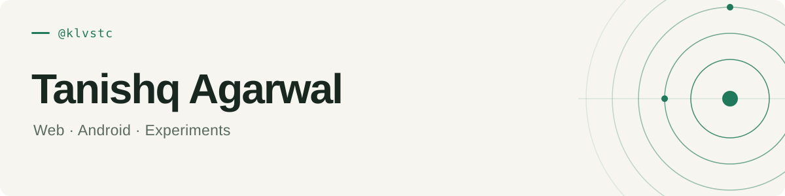

<picture>
  <source media="(prefers-color-scheme: dark)" srcset="assets/header-dark.svg" />
  <source media="(prefers-color-scheme: light)" srcset="assets/header-light.svg" />
  
</picture>

I build web and Android projects, from tools for everyday habits to small interactive experiments.

`React` · `TypeScript` · `JavaScript` · `C++` · `Vite`

## Selected projects

### [Fortify](https://github.com/klvstc/fortify)

A habit-support app with daily streaks, journaling, and AI-assisted reflections. Android application with a React and TypeScript frontend.

### [Colour guessing game](https://github.com/klvstc/klvstc.github.io)

An RGB colour guessing game, alongside TapIt experiments with animation and sound.

### [C++ games](https://github.com/klvstc/C-Games)

Console games built in C++: Hangman and a casino guessing game.

---

[Explore all repositories →](https://github.com/klvstc?tab=repositories)
